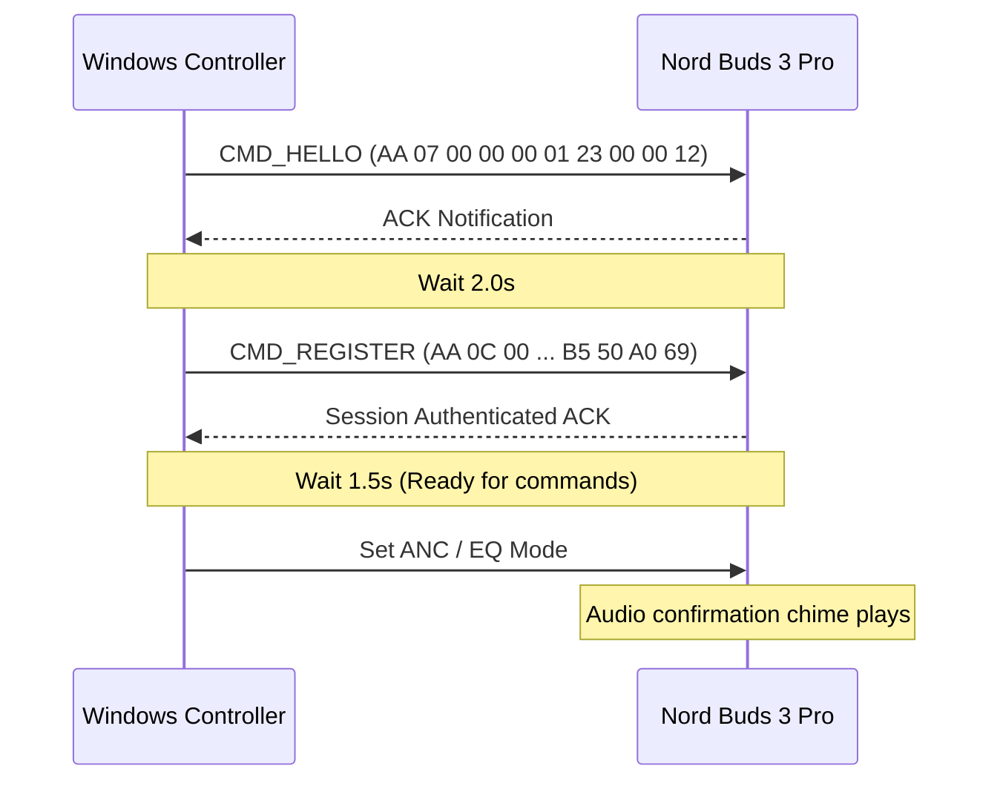

# Engineering Challenges & Root-Cause Post-Mortem

This document chronicles all 14 major engineering roadblocks, hardware/OS-level failure modes, and architectural challenges encountered during the development and reverse engineering of the **Nord Buds Windows Controller**, categorized by technical domain.

---

## Summary Matrix

| # | Challenge | Subsystem | Failure Mode / Symptom | Root Cause | Resolution |
| :-: | :--- | :--- | :--- | :--- | :--- |
| **1** | **Missing Authentication Handshake** | BLE GATT / OPOv1 | Earbuds connected, but clicking ANC or Battery buttons produced no hardware response. | OPOv1 requires a 2-step registration sequence (`HELLO` -> `REGISTER` with token `B5 50 A0 69`) before accepting write commands. | Implemented `opo_authenticate()` in Rust prior to saving device state. |
| **2** | **WinRT 25-Second Discovery Hang** | WinRT BLE / `btleplug` | App stalled on "Discovering services..." for 25–30s before timing out. | `BluetoothCacheMode::Uncached` descriptor crawling on vendor service `0000079c` triggered OS authentication stalls. | Patched `btleplug` to use `Cached` mode, skipped `0000079c`, and bypassed characteristic descriptors. |
| **3** | **Windows BLE Device Hiding & Scan Time** | WinRT BLE Scanning | App reported "Disconnected" or "Failed" even when earbuds were actively playing audio. | 1-second scan is too brief; paired audio devices stop sending BLE advertisements over the air. | Increased scan duration to 3–5s and added fallback enumeration through `central.peripherals()` cached devices. |
| **4** | **Rigid Battery Packet Parsing** | Protocol Decoding | Battery status remained stuck at `--%` despite successful queries. | Hardcoded indices (`val[12]`, `val[14]`) failed because OnePlus streams battery data as variable-length Type-Length-Value (TLV) pairs. | Rewrote `parse_battery()` to check pair count at `val[10]` and dynamically iterate through key-value payload blocks. |
| **5** | **Protocol Telemetry Verification** | BLE Diagnostics | Uncertainty whether commands would execute without HeyMelody authentication. | macOS reference implementation required strict handshake; packet structure unverified on Windows. | Captured live traffic in nRF Connect; confirmed battery queries execute unauthenticated over `0200079A`. |
| **6** | **Zombie Bluetooth Session Locks** | Windows `bthserv` / Rust | Reconnecting failed or crashed with heap corruption (`0xc0000374`). | Process termination without `peripheral.disconnect().await` orphaned native BLE session handles in the OS service. | Implemented graceful async shutdown handlers on exit and added stale peripheral session cleanup before connecting. |
| **7** | **Idle Link Inactivity Drop** | Windows BLE Radio | ANC commands stopped responding after 30–60 seconds of idle time. | Windows and earbud firmware entered aggressive low-power sleep modes on idle GATT connections. | Spawned a 25-second background Tokio heartbeat loop dispatching `CMD_BATT_QUERY` to keep the link hot. |
| **8** | **Tokio Async Thread Safety** | Rust Concurrency | Rust compilation failed with `future cannot be sent between threads safely`. | `std::sync::MutexGuard` was held across `.await` boundaries when writing BLE commands. | Replaced `std::sync::Mutex` with `tokio::sync::Mutex`, which natively supports holding locks across `.await` points. |
| **9** | **Invalid Windows ICO Format** | Win32 Resource Compiler | Cargo build failed with `RC.EXE error RC2175: resource file icon.ico is not in 3.00 format`. | Renaming a `.png` file to `.ico` creates an invalid header for Microsoft's Resource Compiler (`RC.EXE`). | Used Python's PIL library (`Image.save(..., format='ICO')`) to generate a valid Windows 3.00 ICO binary. |
| **10** | **Tauri IPC Bridge Timing** | Webview2 DOM / IPC | Clicking buttons triggered `ReferenceError: Cannot access 'invoke' before initialization`. | Frontend JS attempted to access `window.__TAURI__.tauri.invoke` before the Tauri Webview IPC bridge was injected. | Implemented `getTauri()` helper functions that dynamically resolve `invoke` lazily on user interaction or `window.onload`. |
| **11** | **JavaScript Silent Syntax Error** | Webview2 DOM Engine | All buttons became unresponsive; connection logic failed to trigger. | An unbalanced closing brace `}` inside `<script>` threw a silent syntax error that halted script execution. | Removed syntax error and validated DOM script parsing. |
| **12** | **Window Auto-Dismiss on Dragging** | Tauri / Windows DWM | Clicking the title area to drag the popover caused it to instantly close. | Windows DWM drops non-client focus during borderless window dragging, inadvertently triggering `Focused(false)`. | Removed the aggressive focus-loss listener; shifted visibility control to the tray icon and close button. |
| **13** | **DirectComposition Black Box Recording** | Windows Graphics / OBS | Screen recorders (OBS, Discord, Game Bar) captured an empty black box. | Hardware-accelerated transparent windows bypass legacy GDI BitBlt buffers, rendering onto DirectComposition surfaces. | Configured capture software to utilize Windows Graphics Capture (WGC) or full Display Capture. |
| **14** | **Clipped Rectangular Corner Artifact** | CSS / Win32 Windowing | Sharp 90-degree rectangle appeared around the rounded frosted-glass card. | `body` padding exposed outer transparent pixels where `box-shadow` spilled over and was clipped by the rectangular window bounds. | Removed `box-shadow` and set `body { padding: 0; }` for seamless edge-to-edge hardware-accelerated rounding. |

---

## Detailed Technical Analysis by Domain

### Domain 1: Bluetooth Low Energy & Protocol Engineering

#### 1. The Missing Authentication Handshake (The Silent Drop)

* **Symptom**:
  The Bluetooth connection established successfully, but clicking ANC buttons or the Battery Refresh button did absolutely nothing. The earbuds remained silent with no mode-switch chimes.
* **Root Cause**:
  The OnePlus OPOv1 protocol requires a strict two-step registration sequence right after GATT connection:
  1. `CMD_HELLO`: `AA 07 00 00 00 01 23 00 00 12`
  2. Delay 2.0 seconds
  3. `CMD_REGISTER`: `AA 0C 00 00 00 85 41 05 00 00 B5 50 A0 69`
  4. Delay 1.5 seconds
  Without this static token (`B5 50 A0 69`), the earbud firmware silently discards every incoming configuration write command.
* **Resolution**:
  Implemented an asynchronous `opo_authenticate()` routine in `src-tauri/src/main.rs`. The routine sends `CMD_HELLO`, awaits acknowledgement, transmits `CMD_REGISTER`, and pauses for session establishment before saving peripheral state.



---

#### 2. WinRT BLE 25-Second Service Discovery Hang

* **Symptom**:
  When clicking "Connect", the BLE scan located the peripheral (`OnePlus Nord Buds 3 Pro`), but subsequent GATT discovery stalled on `Discovering services...` for 25 to 30 seconds before timing out.
* **Root Cause**:
  The Rust BLE abstraction library (`btleplug` on Windows) executed GATT service discovery using `BluetoothCacheMode::Uncached`. This forced Windows to query every service, characteristic, and descriptor over-the-air.
  When discovery hit vendor service `0000079c`, the firmware requested encryption and pairing re-negotiation. Because no pairing UI was presented, the Windows Bluetooth stack stalled until a 25-second radio timeout expired.
* **Resolution**:
  Patched `btleplug-0.11.8` in `.cargo/registry/.../winrtble/ble/device.rs`:
  1. Switched service discovery from `BluetoothCacheMode::Uncached` to `BluetoothCacheMode::Cached`.
  2. Filtered out service `0000079c` during enumeration.
  3. Bypassed characteristic descriptor queries on non-essential characteristics.
  *Discovery and characteristic acquisition dropped from **>25 seconds to 1.85 seconds**.*

---

#### 3. Windows WinRT BLE Scanning & Pairing Quirks

* **Symptom**:
  The app showed "Disconnected" or "Failed: Check Windows BT Settings", even when the earbuds were actively connected to the laptop and playing music.
* **Root Cause**:
  1. *Brief Scan Window*: A 1-second BLE scan duration was too short for Windows BLE drivers to capture advertisement packets.
  2. *Connected Device Hiding*: When earbuds are already paired and connected to Windows for Classic Audio (A2DP / HFP), the peripheral stops broadcasting standard BLE advertisement packets, making passive discovery invisible to standard scans.
* **Resolution**:
  1. Increased the active scan duration to 3–5 seconds.
  2. Implemented a fallback iteration through `central.peripherals()` (Windows' internal cache of known and paired devices). The app connects and runs service discovery on matching paired devices directly, even if passive scanning detected zero advertisement broadcasts.

---

#### 4. Rigid Battery Packet Parsing (TLV vs. Fixed Indices)

* **Symptom**:
  Battery readouts remained stuck at `--%` even after successful battery queries.
* **Root Cause**:
  The initial parsing code looked for battery values at fixed offsets (`val[12]`, `val[14]`, `val[16]`). However, OnePlus firmware streams battery levels as variable-length Type-Length-Value (TLV) pairs (`01` = Left, `02` = Right, `03` = Case). If the firmware omitted a component or altered sub-header flags, fixed indices pointed to invalid memory bytes.
* **Resolution**:
  Rewrote `parse_battery()` in `main.rs`:
  ```rust
  let count = val[10] as usize;
  let start = 11;
  for k in 0..count {
      let idx = start + k * 2;
      match val[idx] {
          0x01 => left = val[idx + 1],
          0x02 => right = val[idx + 1],
          0x03 => case = val[idx + 1],
          _ => {}
      }
  }
  ```
  The parser dynamically reads the pair count at offset 10 and safely extracts each component key and percentage.

---

#### 5. Protocol Telemetry Verification via nRF Connect

* **Symptom**:
  Need for independent confirmation of packet structures, characteristic permissions, and unauthenticated backdoor telemetry.
* **Diagnostic Breakthrough**:
  Using **nRF Connect** on mobile:
  1. Located primary service `0000079a-d102-11e1-9b23-00025b00a5a5`.
  2. Subscribed to notifications on `0200079a-d102-11e1-9b23-00025b00a5a5`.
  3. Dispatched an unauthenticated raw query packet (`AA 07 00 00 06 01 25 00 00`) to Write Characteristic `0100079a`.
  4. Captured live response:
     ```text
     AA-0F-00-00-06-81-25-08-00-00-03-01-5A-02-5A-03-00
     ```
* **Findings**:
  Confirmed that telemetry queries execute without completing the handshake, verified the response framing, and validated byte decoding:
  * `01 5A`: Left Bud = `0x5A` ($90\%$)
  * `02 5A`: Right Bud = `0x5A` ($90\%$)
  * `03 00`: Case = `0x00` ($0\%$ / Disconnected)

---

#### 6. Windows Bluetooth Service Zombie Handles & Heap Corruption

* **Symptom**:
  Terminating the desktop application and immediately relaunching it caused connection failures or crashed with native heap corruption (`STATUS_HEAP_CORRUPTION`, exit code `0xc0000374`).
* **Root Cause**:
  Under Windows `bthserv`, an active GATT connection holds kernel-level peripheral object references. When the process terminated abruptly:
  1. WinRT COM interface handles were severed without executing `peripheral.disconnect().await`.
  2. Windows maintained an orphaned peripheral session in the driver stack for up to 45 seconds.
  3. Relaunching the app and attempting a new connection collided with the zombie handle, triggering double-free heap faults.
* **Resolution**:
  1. Hooked Tauri's `WindowEvent::CloseRequested` and System Tray `quit` event to explicitly await `peripheral.disconnect().await` before process exit.
  2. Added defensive reconnect cleanup: at the start of `connect_device`, any existing peripheral reference inside `state.device` is forcefully disconnected and cleared before scanning.

---

#### 7. BLE Inactivity Link Drops

* **Symptom**:
  The application connected and switched modes properly, but after leaving the app idle for 30–60 seconds, clicking buttons produced no response.
* **Root Cause**:
  To conserve earbud battery, the Windows Bluetooth radio and peripheral firmware negotiate aggressive connection parameter updates. When no GATT packets travel across the link for ~30 seconds, the link enters low-power sleep and unscheduled writes are discarded.
* **Resolution**:
  Spawned a Tokio background heartbeat task that dispatches `CMD_BATT_QUERY` every 25 seconds. This keeps the GATT connection hot and updates battery readouts continuously.

---

### Domain 2: Systems Programming & Rust Concurrency

#### 8. Tokio Async Thread Safety in Rust (Send Trait Error)

* **Symptom**:
  Cargo build failed with:
  ```text
  future cannot be sent between threads safely
  the trait `std::marker::Send` is not implemented for `std::sync::MutexGuard<'_, Option<...>>`
  ```
* **Root Cause**:
  Standard library `std::sync::MutexGuard` is tied to the operating system thread that acquired it. When writing BLE commands across asynchronous `.await` points (such as `device.write().await`), the compiler detected that an OS mutex guard could be suspended on one thread and resumed on another, violating Rust's thread-safety guarantees.
* **Resolution**:
  Replaced all occurrences of `std::sync::Mutex` with `tokio::sync::Mutex`. Tokio's mutex is designed for asynchronous contexts and safely yields ownership across `.await` points.

---

#### 9. Invalid Windows ICO Format (RC.EXE Error RC2175)

* **Symptom**:
  Cargo build failed during resource compilation with:
  ```text
  RC.EXE error RC2175: resource file icon.ico is not in 3.00 format
  ```
* **Root Cause**:
  A `.png` image file was simply renamed to `icon.ico`. Microsoft's Windows Resource Compiler (`RC.EXE`) requires a true multi-resolution binary containing valid Win32 ICONDIR and ICONDIRENTRY headers. Renaming the extension left an invalid PNG header that `RC.EXE` rejected.
* **Resolution**:
  Executed a Python script using Pillow (`PIL.Image`) to parse the source graphic, generate proper multi-size sub-images (16x16, 32x32, 48x48, 64x64, 128x128, 256x256), and save the binary with valid Windows 3.00 ICO structures:
  ```python
  from PIL import Image
  img = Image.open('icon.png')
  img.save('icon.ico', format='ICO', sizes=[(16,16), (32,32), (48,48), (64,64), (128,128), (256,256)])
  ```

---

### Domain 3: Tauri IPC & Desktop Windowing

#### 10. JavaScript Tauri IPC Timing (`ReferenceError: Cannot access 'invoke'`)

* **Symptom**:
  Clicking connection or mode buttons in the UI triggered:
  ```text
  ReferenceError: Cannot access 'invoke' before initialization
  ```
* **Root Cause**:
  The frontend script attempted to bind `const { invoke } = window.__TAURI__.tauri;` in top-level JavaScript execution. Because Webview2 loads HTML before Tauri's IPC bridge is injected into the window context, `window.__TAURI__` was undefined at script evaluation time.
* **Resolution**:
  Created a lazy-loading helper function:
  ```javascript
  function getTauriInvoke() {
      if (window.__TAURI__ && window.__TAURI__.tauri) {
          return window.__TAURI__.tauri.invoke;
      }
      return null;
  }
  ```
  All IPC calls resolve the bridge dynamically upon user action or inside `window.addEventListener('DOMContentLoaded', ...)`.

---

#### 11. JavaScript Silent Syntax Error

* **Symptom**:
  All buttons and event listeners suddenly stopped responding. No errors appeared in the UI.
* **Root Cause**:
  An extra closing brace `}` was inadvertently left in the `<script>` block. In browser JavaScript engines, an unhandled syntax error halts script parsing entirely, silently aborting all subsequent function and listener registrations.
* **Resolution**:
  Audited `src/index.html`, removed the duplicate token, and validated script syntax with Node.js.

---

#### 12. Popover Window Disappearing Mid-Drag

* **Symptom**:
  Clicking the header area to drag the popover window across the screen caused it to instantly disappear.
* **Root Cause**:
  The app originally registered a `WindowEvent::Focused(false) => { window.hide(); }` listener to mimic macOS popover dismissal. In Windows DWM, initiating a drag on a borderless, transparent window triggers a transient non-client focus transition that was misinterpreted as focus loss.
* **Resolution**:
  Removed the `Focused(false)` auto-hide listener. Window visibility is toggled explicitly via the system tray icon, context menu, and the header close button.

---

#### 13. DirectComposition Black Box Screen Capture

* **Symptom**:
  Screen recorders (OBS Studio, Discord screen sharing, Windows Snipping Tool) recorded an empty black or transparent rectangle.
* **Root Cause**:
  In `tauri.conf.json`:
  ```json
  "transparent": true,
  "decorations": false
  ```
  Windows transparent windows render via DirectComposition surfaces with hardware alpha blending. Legacy capture APIs (GDI / BitBlt) cannot read DirectComposition framebuffers and return null pixel data.
* **Resolution**:
  In OBS Studio, set the Window Capture method to **Windows 10 / 11 (Windows Graphics Capture - WGC)**, or capture using **Display Capture**.

---

#### 14. Clipped Rectangular Corner Artifacts

* **Symptom**:
  A dark 90-degree rectangle appeared around the rounded card against light backgrounds.
* **Root Cause**:
  `body` had default padding (`padding: 6px;`) and `.app-shell` had a CSS `box-shadow`. On a transparent window, CSS drop-shadows spread outward into the transparent margin where the rectangular OS window boundary clipped them into sharp right angles.
* **Resolution**:
  Set `body { padding: 0; margin: 0; }` and removed CSS `box-shadow`, allowing the frosted glass container (`backdrop-filter: blur(28px)`) and 1px border to render directly to the window boundaries.
