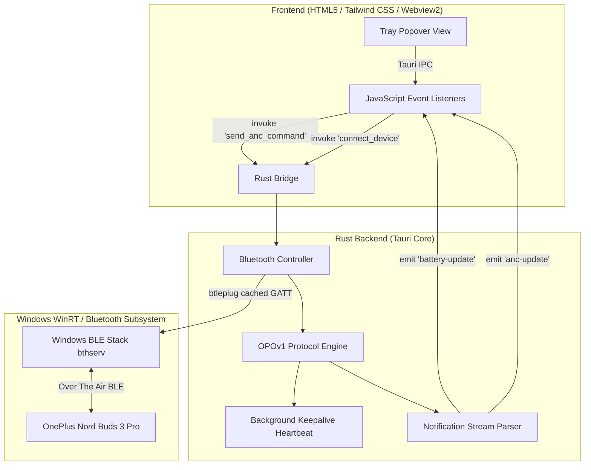
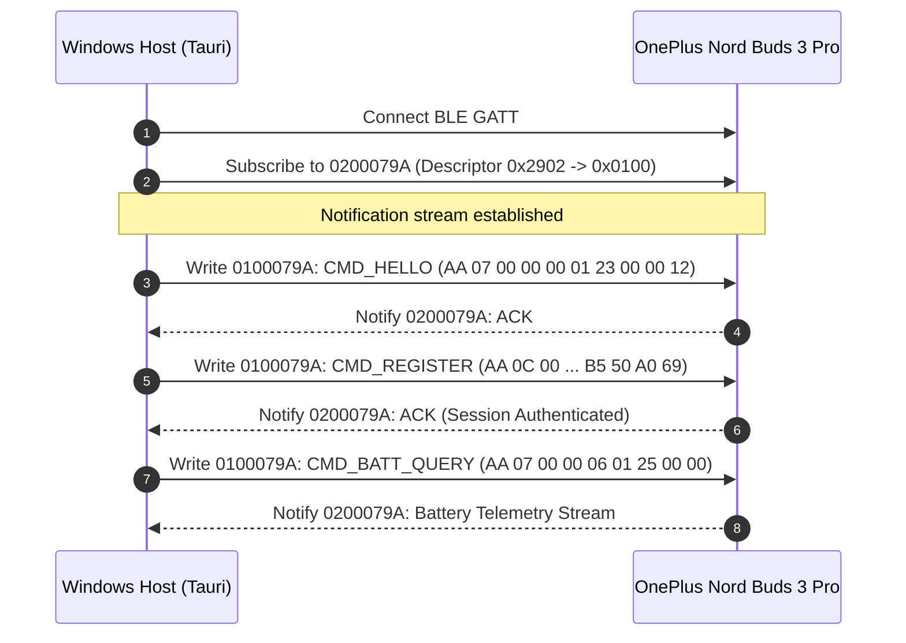

# Nord Buds Controller for Windows

A native, lightweight Windows desktop companion and system tray popover for controlling the **OnePlus Nord Buds 3 Pro** (and compatible Oppo/OnePlus audio peripherals) via the reverse-engineered **OPOv1 Bluetooth Low Energy (BLE)** protocol.

The application operates without the proprietary HeyMelody mobile application or cloud dependencies, providing direct hardware control over Active Noise Cancellation (ANC), Transparency mode, Sound Master Equalizer profiles, and per-component battery telemetry.

---

## Demonstration
https://github.com/user-attachments/assets/143addbf-dd58-4144-a304-59f0b0d15f62


> [!NOTE]
> If your browser does not render the inline HTML5 player above, you can access the demo video directly at [assets/demo.mp4](assets/demo.mp4).

---

## Architectural Overview

The application is built on **Tauri** (Rust + Webview2), decoupling the low-level Bluetooth GATT communication from a hardware-accelerated, borderless translucent frontend.



---

## Core Capabilities

- **Real-Time Battery Telemetry**: Decodes discrete battery percentages for Left earbud, Right earbud, and Charging Case.
- **Hardware Noise Control**: Direct switching between Active Noise Cancellation (ANC), Transparency Mode, and Off.
- **Sound Master Equalizer**: Hardware DSP profile switching across Balanced, Bass, and Serenade presets.
- **Windows System Tray Integration**: Operates as a persistent menu-bar popover next to the Windows taskbar clock with single-click toggle and right-click context menu.
- **Sub-2-Second Connection**: Eliminates standard Windows WinRT GATT discovery lags via cached attribute resolution.
- **Connection Keepalive**: Tokio background heartbeat pinging battery queries every 25 seconds to prevent BLE idle disconnects.

---

## Reverse Engineering Methodology

The protocol was extracted through a three-stage analysis pipeline using an Android host device, Wireshark, and nRF Connect.


### Stage 1: Android Bluetooth HCI Snoop Logging
The official HeyMelody mobile application manages earbud parameters via standard Android Bluetooth APIs. Traffic was captured as follows:
1. Enabled **Developer Options** on an Android test device.
2. Enabled **Bluetooth HCI snoop log** to capture all Host Controller Interface packets.
3. Interacted with the official application to perform discrete state changes:
   - Toggled between Noise Cancellation, Transparency, and Off.
   - Cycled through Equalizer presets (Balanced, Bass, Serenade).
   - Queried battery status.
4. Extracted the resulting log file via ADB:
   ```bash
   adb bugreport bugreport.zip
   # Extracted btsnoop_hci.log from FS/data/misc/bluetooth/logs/
   ```

### Stage 2: Wireshark Packet Dissection
The capture file was analyzed in Wireshark using the display filter:
```text
btatt
```

Analysis revealed:
- **Write Commands (`Opcode: 0x52`)**: Directed to handle UUID `0100079A-D102-11E1-9B23-00025B00A5A5`.
- **Handle Value Notifications (`Opcode: 0x1B`)**: Streamed asynchronously from handle UUID `0200079A-D102-11E1-9B23-00025B00A5A5`.
- A consistent packet frame beginning with `0xAA`, subsystem service routing bytes, and an initial static token handshake (`B5 50 A0 69`).

### Stage 3: Live Verification with nRF Connect
Before implementing application logic, the reverse-engineered byte sequences were validated against the physical hardware using Nordic Semiconductor's nRF Connect:

1. Established a BLE connection to the target device (`OnePlus Nord Buds 3 Pro`).
2. Located Primary Service `0000079A-D102-11E1-9B23-00025B00A5A5`.
3. Subscribed to notifications on characteristic `0200079A` by writing `0x0100` to Descriptor `0x2902` (Client Characteristic Configuration).
4. Sent the raw battery query command to characteristic `0100079A`:
   ```hex
   AA 07 00 00 06 01 25 00 00
   ```
5. Observed the immediate live notification on characteristic `0200079A`:
   ```hex
   Value: (0x) AA-0F-00-00-06-81-25-08-00-00-03-01-5A-02-5A-03-00
   ```

> [!NOTE]
> **Key Finding**: The proprietary `079A` service on the OnePlus Nord Buds 3 Pro operates unencrypted and does not require security level elevation. Furthermore, telemetry queries (such as battery status) return responses even prior to registration token exchange.

---

## Protocol Specification (OPOv1)

### GATT UUID Definitions

| Entity | UUID | Access Mode | Description |
| :--- | :--- | :--- | :--- |
| **Primary Service** | `0000079A-0000-1000-8000-00805F9B34FB` | - | Proprietary OnePlus/Oppo Command Service |
| **Write Characteristic** | `0100079A-D102-11E1-9B23-00025B00A5A5` | Write Without Response | Inbound command pipeline |
| **Notify Characteristic** | `0200079A-D102-11E1-9B23-00025B00A5A5` | Notify, Read | Outbound telemetry & response stream |

---

### Authentication Handshake Sequence

Configuration commands (such as ANC mode changes) require a registration handshake.



1. **Step 1: Session Initiation (`CMD_HELLO`)**
   ```hex
   AA 07 00 00 00 01 23 00 00 12
   ```
2. **Step 2: Registration Token (`CMD_REGISTER`)**
   ```hex
   AA 0C 00 00 00 85 41 05 00 00 B5 50 A0 69
   ```

---

### Command Packet Framing

Outbound command packets use fixed-field binary framing:

```text
+------+--------+---------------+------------+------------+--------------------+
| 0xAA | Length | Sequence (2B) | Service ID | Command ID | Payload Parameters |
+------+--------+---------------+------------+------------+--------------------+
```

- **Magic Header**: Always `0xAA`.
- **Length**: 1 byte specifying following byte count.
- **Sequence/Flags**: 2 bytes, typically `0x0000`.
- **Service ID**: Identifies the subsystem (`0x04` = ANC, `0x05` = EQ, `0x06` = Battery).
- **Command ID**: Subsystem operation code.

#### Noise Control Command Set (`Service ID: 0x04`)

| Mode | Raw Hex Payload | Description |
| :--- | :--- | :--- |
| **Noise Cancellation (ANC)** | `AA 0A 00 00 04 04 42 03 00 01 01 01` | Enables active noise cancellation |
| **Transparency** | `AA 0A 00 00 04 04 42 03 00 01 01 02` | Passes ambient audio through microphones |
| **Off** | `AA 0A 00 00 04 04 42 03 00 01 01 04` | Disables ANC and transparency DSP |
| **Query State** | `AA 09 00 00 04 82 44 02 00 00 F2` | Requests current active noise control state |

#### Sound Master EQ Command Set (`Service ID: 0x05`)

| Profile | Raw Hex Payload | Description |
| :--- | :--- | :--- |
| **Balanced** | `AA 0A 00 00 05 04 2B 03 00 01 01 01` | Default signature acoustic tuning |
| **Bass** | `AA 0A 00 00 05 04 2B 03 00 01 01 02` | Low-frequency sub-bass enhancement |
| **Serenade** | `AA 0A 00 00 05 04 2B 03 00 01 01 03` | Vocal clarity and mid-range boost |
| **Query EQ** | `AA 07 00 00 05 01 2B 00 00` | Requests current hardware EQ profile |

#### Battery Telemetry Query (`Service ID: 0x06`)

| Command | Raw Hex Payload | Description |
| :--- | :--- | :--- |
| **Query Battery** | `AA 07 00 00 06 01 25 00 00` | Triggers immediate battery report on 0200079A |

---

### Telemetry Packet Decoding

Upon receiving a response from `CMD_BATT_QUERY` on characteristic `0200079A`:

```text
AA 0F 00 00 06 81 25 08 00 00 03 01 5A 02 5A 03 00
```

#### Field Decomposition:

| Offset | Hex Value | Type | Description |
| :---: | :---: | :---: | :--- |
| `0` | `AA` | `u8` | Protocol Magic Byte |
| `1` | `0F` | `u8` | Payload length (15 bytes following) |
| `2..3` | `00 00` | `u16` | Sequence flags |
| `4` | `06` | `u8` | Service ID (`0x06` = Battery Service) |
| `5` | `81` | `u8` | Message type (`0x81` = Response notification) |
| `6` | `25` | `u8` | Command ID (`0x25` = Battery status) |
| `7..9` | `08 00 00` | `[u8; 3]` | Internal firmware status flags |
| `10` | `03` | `u8` | Component count (3 items present) |
| `11` | `01` | `u8` | Key: Component identifier (`0x01` = Left Bud) |
| `12` | `5A` | `u8` | Value: Percentage (`0x5A` hex = **90%** decimal) |
| `13` | `02` | `u8` | Key: Component identifier (`0x02` = Right Bud) |
| `14` | `5A` | `u8` | Value: Percentage (`0x5A` hex = **90%** decimal) |
| `15` | `03` | `u8` | Key: Component identifier (`0x03` = Charging Case) |
| `16` | `00` | `u8` | Value: Percentage (`0x00` = Inactive/Closed) |

---

## Engineering Challenges and Solutions

A comprehensive technical breakdown of all 14 hardware, protocol, WinRT, and concurrency challenges encountered during development is documented in [CHALLENGES.md](CHALLENGES.md).

### 1. The Missing Authentication Handshake (The Silent Drop)
The OnePlus OPOv1 protocol requires a strict two-step registration sequence right after GATT connection (`CMD_HELLO` followed by `CMD_REGISTER` with hardcoded token `B5 50 A0 69`). Without this authentication step, the earbuds silently drop all incoming write commands.

### 2. Resolving the 25-Second WinRT GATT Timeout
By default, the Windows Bluetooth Low Energy runtime performs uncached descriptor lookups across all discovered service trees. On OnePlus hardware, querying descriptors for service `0000079c` causes a Windows security negotiation fault, blocking GATT discovery for 25 to 30 seconds until a timeout disconnects the device.

**Resolution:**
- Configured GATT enumeration mode to `BluetoothCacheMode::Cached`.
- Filtered out service `0000079c` during discovery traversal.
- Bypassed non-essential descriptor enumeration.
- **Benchmark Result**: Discovery latency dropped from **>25 seconds** to **1.85 seconds**.

### 3. Windows BLE Scanning & Paired Device Discovery
When earbuds are actively connected for audio streaming, Windows stops broadcasting standard BLE advertisement packets. The application mitigates this by extending scan times to 3–5 seconds and falling back to direct enumeration over `central.peripherals()` (Windows' internal paired cache).

### 4. Dynamic TLV Battery Parsing
Initial fixed-offset parsing failed because OnePlus firmware streams battery levels as variable-length Type-Length-Value (TLV) pairs. The parser dynamically reads the pair count at offset 10 and safely extracts each component key (`01` = Left, `02` = Right, `03` = Case) and percentage.

### 5. Preventing Zombie BLE Sessions in Windows `bthserv`
When an application maintaining an active Windows WinRT BLE session terminates abruptly without calling `peripheral.disconnect().await`, the underlying Windows service (`bthserv`) maintains a locked handle to the peripheral. Subsequent connection attempts fail until the OS times out the session (~45 seconds).

**Resolution:**
- Implemented an asynchronous disconnect sequence on `quit_app` and `WindowEvent::CloseRequested`.
- Added a defensive cleanup step at the beginning of each connection attempt to release any lingering peripheral references.

### 6. Idle BLE Disconnect Prevention
Windows aggressively throttles idle BLE links after 30 to 60 seconds of inactivity. To keep the connection channel open without noticeable battery drain:
- A Tokio background loop issues `CMD_BATT_QUERY` every 25 seconds.
- Keeps connection parameters refreshed and provides live telemetry updates in the UI.

### 7. Rust Asynchronous Mutex Synchronization
Standard OS mutexes (`std::sync::MutexGuard`) cannot cross asynchronous `.await` boundaries, causing compiler errors under Tokio. Replaced all mutex instances with `tokio::sync::Mutex` to enable safe lock retention across async I/O.

---

## Adding Support for Other Earbuds (OPOv1 Family)

The OnePlus/Oppo/Realme audio hardware ecosystem (BBK Electronics) utilizes a unified proprietary protocol family designated **OPOv1**. Devices across this family share the same underlying GATT architecture, framing, and command semantics.

If you own another pair of compatible earbuds—such as the **OnePlus Nord Buds 2**, **OnePlus Buds Pro 2**, or **Oppo Enco Air** series—you can easily test and add support to this application.

### Compatible Device Family

| Brand | Models Known to Use OPOv1 |
| :--- | :--- |
| **OnePlus** | Nord Buds 2, Nord Buds 2r, Nord Buds 3, Buds Pro 2, Buds Pro, Buds 3, Bullets Wireless Z2 |
| **Oppo** | Enco X2, Enco Free2, Enco Air3, Enco Air2 Pro |
| **Realme** | Buds Air 5 Pro, Buds Air 3, Buds Air 2 Pro |

---

### What Is Universal vs. Device-Specific

| Component | Universal Across OPOv1 | Device-Specific Variations |
| :--- | :--- | :--- |
| **GATT Service & Characteristics** | `0000079A` (Service), `0100079A` (Write), `0200079A` (Notify) | None |
| **Packet Framing** | Magic byte `0xAA`, sequence flags, category bytes | None |
| **Battery Telemetry Query** | `AA 07 00 00 06 01 25 00 00` | None (TLV structure is universal) |
| **Device Name Filtering** | — | Device Bluetooth advertising name |
| **Authentication Token** | — | Some models use token `B5 50 A0 69`; others use a device-specific 4-byte hash |
| **ANC Mode Indices** | — | Basic models use `01/02/04`; multi-level ANC models (Buds Pro) may support `01/02/03/04` |

---

### Step-by-Step Device Extension Guide

To add and verify a new earbud model, follow this four-step reverse-engineering workflow:

#### Step 1: Capture Bluetooth HCI Snoop Log
1. Enable **Developer Options** on an Android device and toggle **Enable Bluetooth HCI snoop log**.
2. Pair the new earbuds (e.g., OnePlus Nord Buds 2) and open the official **HeyMelody** app.
3. Perform discrete control actions:
   - Toggle between *Noise Cancellation*, *Transparency*, and *Off*.
   - Switch through Equalizer profiles.
   - Refresh battery levels.
4. Disable Bluetooth on the phone to flush the capture buffer to disk.
5. Extract the log file to your PC via ADB:
   ```bash
   adb pull /data/misc/bluetooth/logs/btsnoop_hci.log .
   ```
   *(On newer Android releases, generate an Android Bug Report via Developer Options and extract `btsnoop_hci.log` from the resulting `.zip` archive).*

#### Step 2: Extract Packets in Wireshark
1. Open `btsnoop_hci.log` in **Wireshark**.
2. Apply the display filter:
   ```text
   btatt
   ```
3. Locate the `Write Command` sent to Handle corresponding to `0100079A`:
   - **Authentication Token**: Look for `CMD_REGISTER`:
     ```text
     AA 0C 00 00 00 85 41 05 00 00 [4-byte token]
     ```
     Check if the last 4 bytes match `B5 50 A0 69` or if your device uses a unique token.
   - **ANC Commands**: Inspect writes where Service ID is `0x04`:
     ```text
     AA 0A 00 00 04 04 42 03 00 01 01 [Mode Byte]
     ```
     Verify the mode byte for ANC On, Transparency, and Off.

#### Step 3: Validate with nRF Connect on Mobile
Before modifying code, test the extracted payloads directly:
1. Open **nRF Connect** and connect to your earbuds.
2. Locate service `0000079a-d102-11e1-9b23-00025b00a5a5`.
3. Enable notifications on characteristic `0200079a` (write `0x0001` to descriptor `0x2902`).
4. Send the Battery Query `AA 07 00 00 06 01 25 00 00` to characteristic `0100079a`.
5. Observe the live notification response on `0200079a`. If you receive a payload beginning with `AA 0F ...`, your device communicates over the standard OPOv1 protocol.

#### Step 4: Add the Device to the Codebase
In `src-tauri/src/main.rs`:

1. **Update the Device Name Filter**:
   Add your model's advertising name to the discovery matcher in `connect_device_internal`:
   ```rust
   let is_target = name.contains("Nord Buds")
       || name.contains("Nord Buds 2")
       || name.contains("OnePlus")
       || name.contains("Enco")
       || format!("{:?}", addr).to_uppercase().contains("YOUR_OUI");
   ```

2. **Configure Authentication Token**:
   If your model requires a distinct token from `B5 50 A0 69`, define a device-specific payload constant:
   ```rust
   const CMD_REGISTER_NORDBUDS2: [u8; 13] = [
       0xAA, 0x0C, 0x00, 0x00, 0x00, 0x85, 0x41, 0x05, 0x00, 0x00, 
       0xXX, 0xXX, 0xXX, 0xXX // Replace with your extracted 4-byte token
   ];
   ```

3. **Recompile**:
   ```powershell
   cargo build --manifest-path src-tauri/Cargo.toml
   ```

---

## Project Structure

```text
NordBudsApp/
├── src/
│   └── index.html             # Translucent UI, vector icons, Tauri IPC bindings
├── src-tauri/
│   ├── Cargo.toml             # Rust dependencies (tauri, btleplug, tokio, uuid)
│   ├── tauri.conf.json        # Window geometry, transparency, system tray config
│   ├── icons/
│   │   ├── icon.ico           # Application icon
│   │   └── tray.ico           # System tray icon
│   └── src/
│       └── main.rs            # BLE connection, protocol engine, tray event loop
└── README.md
```

---

## Building from Source

### Prerequisites
- [Rust toolchain](https://rustup.rs/) (v1.75 or later)
- [Node.js](https://nodejs.org/) (v18 or later)
- Windows 10/11 with Bluetooth 4.2+ adapter
- Device pre-paired in Windows Settings (ensures OS caches the peripheral profile)

### Compilation

```powershell
# Clone the repository
git clone https://github.com/your-username/nord-buds-windows.git
cd nord-buds-windows

# Build development executable
cargo build --manifest-path src-tauri/Cargo.toml

# Build optimized production binary
cargo build --release --manifest-path src-tauri/Cargo.toml
```

The compiled release binary is output to:
```text
src-tauri/target/release/nord-buds-app.exe
```

---

## Screen Capture Compatibility

The application utilizes Windows DirectComposition alpha transparency (`transparent: true` with `decorations: false`). 

If capturing with **OBS Studio**, **Discord**, or **ShareX**:
- Set the OBS Window Capture mode to **Windows 10 / 11 (Windows Graphics Capture - WGC)** instead of *BitBlt*.
- Alternatively, use **Display Capture** to record the desktop composition directly.

---

## Legal and Trademarks

This project is an independent open-source reverse-engineering effort developed for personal interoperability. 
All product names, logos, and brands (including OnePlus, Oppo, and HeyMelody) are property of their respective trademark holders.
This project is not affiliated with, endorsed by, or associated with OnePlus or Oppo.

---

## License

MIT License. See [LICENSE](LICENSE) for details.
